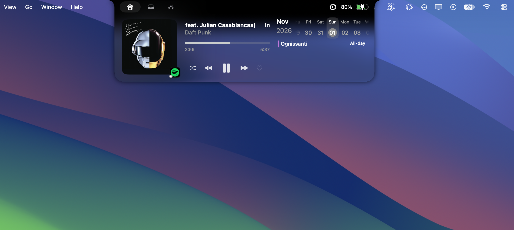
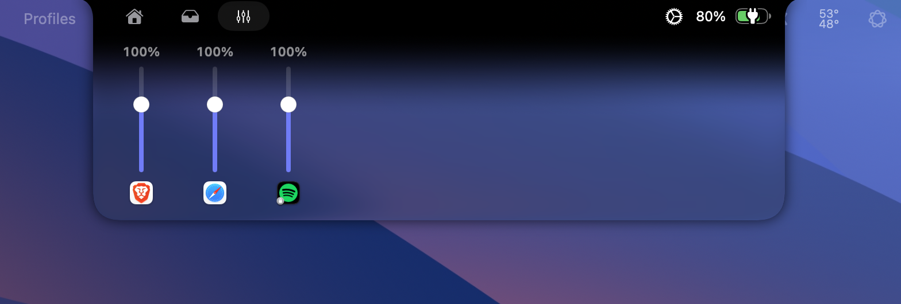
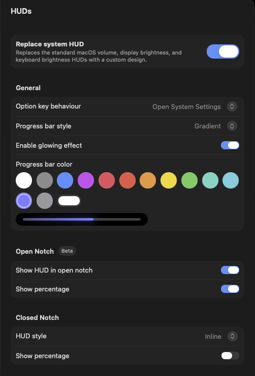

<div align="center">

# TheBoringNotch : Liquid Glass

**A Liquid Glass remake of [Boring Notch](https://github.com/TheBoredTeam/boring.notch) for macOS 26 and later.**<br>
**Un remake in stile Liquid Glass di [Boring Notch](https://github.com/TheBoredTeam/boring.notch) per macOS 26 e successivi.**

[](LICENSE)
[](#requirements)
[](https://developer.apple.com/swift/)

[English](#english) · [Italiano](#italiano)

<br>



<br><br>

<table>
  <tr>
    <td align="center" width="60%">
      <br>
      <sub><b>Mixer</b>: per-app volume, powered by OpenSoundSource</sub>
    </td>
    <td align="center" width="40%">
      <br>
      <sub><b>HUD</b>: color presets, custom color, live preview</sub>
    </td>
  </tr>
</table>

</div>

---

## English

TheBoringNotch : Liquid Glass is a personal remake of **[Boring Notch](https://github.com/TheBoredTeam/boring.notch)** by TheBoredTeam. It keeps everything that makes the original great (music, calendar, shelf, HUDs, smooth Apple-style animations) and redesigns the look for the Liquid Glass era, plus a few new features.

> This is not a fork and is not affiliated with TheBoredTeam. All credit for the original app goes to them. The project stays under the same **GPL-3.0** license.

### What's new

| | |
|---|---|
| **Liquid Glass** | The open notch becomes real system glass (`glassEffect`), adapting live to the wallpaper and the apps underneath. The closed notch stays pure black so it blends with the hardware notch. |
| **Glass intensity** | A 0–100% slider. 0% is the classic black look; 100% uses the clearer glass variant. |
| **Seamless top edge** | The black band under the physical notch melts into the glass with an eased gradient: no visible seam. |
| **Readable by design** | A dimming floor keeps text legible on any background. *Reduce Transparency* switches back to solid black; *Increase Contrast* raises the floor. |
| **HUD colors** | Volume, brightness and keyboard HUDs: white, system accent, 11 macOS system colors or any custom color, with gradient, glow and a live preview. |
| **Mixer** | A new notch tab with one vertical fader per app playing sound (0–150%), native and driver-free. See below. |
| **Spotify everywhere** | Shows what you are playing on your phone, speakers or TV, even with the Spotify app closed on the Mac. Works with **Spotify Free**, through Last.fm. |
| **Quiet idle state** | When nothing plays on any device, a calm Spotify card replaces the placeholder track. |

### Mixer: native OpenSoundSource engine

The Mixer tab is built on the audio engine of **[OpenSoundSource](https://github.com/jimmyxan/OpenSoundSource)**, my per-app volume app for the menu bar. It is integrated natively, not as a plugin or a separate process:

- **CoreAudio process taps** (macOS 14.2+), no virtual audio driver to install.
- **Helper processes are grouped under their app**: Safari (WebKit GPU process), Chrome, Teams and Electron apps show up as one fader, a problem already solved in OpenSoundSource.
- **0–150%** with a magnetic snap at 100% and a soft-knee limiter, so boosted audio does not clip.
- **Zero cost at 100%**: the tap is removed when an app is back at unity gain.
- **Follows your devices**: volumes carry over when the default output changes, for example when you put on AirPods.
- **Fine control in a small space**: relative dragging (the knob never jumps), hold **⌥ Option** for 4× finer steps, click the percentage to reset, click the icon to mute.

The first time you move a fader, macOS asks for permission to capture app audio.

### Performance

- The glass is composited by WindowServer: no screen capture and no per-frame CPU work. It exists only while the notch is open and the slider is above 0%.
- The Mixer polls once per second only while its tab is visible, every 3 s while a custom volume is active, and not at all otherwise.
- With Spotify closed, Last.fm is checked every 15 s while music plays and every 60 s when idle. Spotify is never launched in the background.

### Spotify on other devices with Last.fm (tutorial)

Spotify's own Web API now requires Premium. Last.fm does not: Spotify sends your plays to Last.fm from every device, Free accounts included.

1. **Create a Last.fm account** at [last.fm/join](https://www.last.fm/join) (skip if you have one).
2. **Connect Spotify**: open [last.fm/settings/applications](https://www.last.fm/settings/applications) and click **Connect** next to *Spotify Scrobbling*.
3. **Get a free API key**: go to [last.fm/api/account/create](https://www.last.fm/api/account/create). Enter any application name (for example *TheBoringNotch*) and a short description. Leave *Callback URL* empty. Submit and copy the **API key**. You do not need the *Shared secret*: do not paste it anywhere.
4. **Set up the notch**: open the notch settings › **Media**, set **Music Source** to **Spotify**, then fill **Last.fm username** and **Last.fm API key** in *Spotify on other devices*.
5. **Try it**: close Spotify on the Mac and play something on your phone. Within about 15 seconds the notch shows the track. Your Last.fm profile should say *Scrobbling now*.

Good to know:
- Read-only: track, artist, album and artwork. Progress is estimated. Playback controls work only when the Spotify app is open on the Mac (no Premium needed).
- When you pause, Last.fm keeps the track as *now playing* for a few minutes.
- Your API key is stored only in the app's local preferences, never in this repository.

### Requirements

- macOS 14 or later. Liquid Glass needs macOS 26; on older systems the notch uses the classic blur.
- Mixer: macOS 14.2 or later.
- Xcode 26 to build.

### Build

```bash
git clone https://github.com/jimmyxan/TheBoringNotch-LiquidGlass.git
cd TheBoringNotch-LiquidGlass
open boringNotch.xcodeproj
```

Select the `boringNotch` scheme and press **Run**. Accessibility permission is required to replace the system HUD.

> Automatic update checks are disabled: the bundled Sparkle feed belongs to the original Boring Notch and would replace this build.

### Credits

- **[Boring Notch](https://github.com/TheBoredTeam/boring.notch)** by TheBoredTeam and contributors: the original app this remake is built on.
- **[OpenSoundSource](https://github.com/jimmyxan/OpenSoundSource)**: the per-app volume engine behind the Mixer.
- Licensed under **GPL-3.0**, like the original. See [LICENSE](LICENSE) and [THIRD_PARTY_LICENSES](THIRD_PARTY_LICENSES).

---

## Italiano

TheBoringNotch : Liquid Glass è un remake personale di **[Boring Notch](https://github.com/TheBoredTeam/boring.notch)** di TheBoredTeam. Mantiene tutto ciò che rende ottimo l'originale (musica, calendario, shelf, HUD, animazioni fluide in stile Apple) e ridisegna l'aspetto per l'era Liquid Glass, con qualche funzione nuova.

> Non è un fork e non è affiliato a TheBoredTeam. Tutto il merito dell'app originale va a loro. Il progetto resta sotto la stessa licenza **GPL-3.0**.

### Novità

| | |
|---|---|
| **Liquid Glass** | Il notch aperto diventa vero vetro di sistema (`glassEffect`), che si adatta in tempo reale allo sfondo e alle app sottostanti. Il notch chiuso resta nero pieno, così si fonde con il notch fisico. |
| **Intensità del vetro** | Uno slider da 0 a 100%. Lo 0% è il classico nero; il 100% usa la variante di vetro più trasparente. |
| **Bordo superiore senza stacchi** | La fascia nera sotto il notch fisico sfuma nel vetro con un gradiente morbido: nessuna linea visibile. |
| **Leggibile per design** | Uno strato scuro minimo mantiene i testi leggibili su qualsiasi sfondo. *Riduci trasparenza* torna al nero pieno; *Aumenta contrasto* scurisce di più. |
| **Colori HUD** | HUD di volume, luminosità e tastiera: bianco, accento di sistema, 11 colori di sistema macOS o qualsiasi colore personalizzato, con gradiente, glow e anteprima dal vivo. |
| **Mixer** | Una nuova tab del notch con uno slider verticale per ogni app che emette suono (0–150%), nativo e senza driver. Vedi sotto. |
| **Spotify ovunque** | Mostra cosa ascolti su telefono, casse o TV, anche con l'app Spotify chiusa sul Mac. Funziona con **Spotify Free**, tramite Last.fm. |
| **Stato di attesa discreto** | Quando non suona nulla su nessun dispositivo, una scheda Spotify sobria sostituisce il brano segnaposto. |

### Mixer: motore nativo di OpenSoundSource

La tab Mixer usa il motore audio di **[OpenSoundSource](https://github.com/jimmyxan/OpenSoundSource)**, la mia app per il volume per singola app dalla barra dei menu. È integrato in modo nativo, non come plugin o processo separato:

- **Process tap di CoreAudio** (macOS 14.2+), nessun driver audio virtuale da installare.
- **I processi helper sono raggruppati sotto la loro app**: Safari (processo GPU di WebKit), Chrome, Teams e le app Electron compaiono come un solo slider, problema già risolto in OpenSoundSource.
- **0–150%** con aggancio magnetico al 100% e limitatore morbido, così l'audio amplificato non distorce.
- **Costo zero al 100%**: il tap viene rimosso quando un'app torna al volume pieno.
- **Segue i tuoi dispositivi**: i volumi restano quando cambia l'uscita predefinita, per esempio quando indossi le AirPods.
- **Controllo fine in poco spazio**: trascinamento relativo (il pallino non salta), tieni premuto **⌥ Option** per passi 4 volte più fini, clic sulla percentuale per tornare al 100%, clic sull'icona per silenziare.

La prima volta che muovi uno slider, macOS chiede il permesso di catturare l'audio delle app.

### Prestazioni

- Il vetro è composto da WindowServer: nessuna cattura dello schermo e nessun lavoro della CPU a ogni frame. Esiste solo a notch aperto e con lo slider sopra lo 0%.
- Il Mixer si aggiorna una volta al secondo solo con la sua tab visibile, ogni 3 s se c'è un volume personalizzato attivo, altrimenti mai.
- Con Spotify chiuso, Last.fm viene controllato ogni 15 s durante l'ascolto e ogni 60 s quando non suona nulla. Spotify non viene mai avviato in background.

### Spotify su altri dispositivi con Last.fm (tutorial)

La Web API di Spotify ora richiede Premium. Last.fm no: Spotify invia a Last.fm i tuoi ascolti da ogni dispositivo, anche con account Free.

1. **Crea un account Last.fm** su [last.fm/join](https://www.last.fm/join) (salta se ne hai già uno).
2. **Collega Spotify**: apri [last.fm/settings/applications](https://www.last.fm/settings/applications) e premi **Connect** accanto a *Spotify Scrobbling*.
3. **Ottieni una chiave API gratuita**: vai su [last.fm/api/account/create](https://www.last.fm/api/account/create). Inserisci un nome qualsiasi (per esempio *TheBoringNotch*) e una breve descrizione. Lascia vuoto *Callback URL*. Invia e copia la **API key**. Lo *Shared secret* non serve: non incollarlo da nessuna parte.
4. **Configura il notch**: apri le impostazioni del notch › **Media**, imposta **Music Source** su **Spotify**, poi compila **Last.fm username** e **Last.fm API key** in *Spotify on other devices*.
5. **Prova**: chiudi Spotify sul Mac e fai partire un brano dal telefono. Entro circa 15 secondi il notch mostra il brano. Il tuo profilo Last.fm dovrebbe indicare *Scrobbling now*.

Da sapere:
- Solo lettura: brano, artista, album e copertina. L'avanzamento è stimato. I controlli funzionano solo con l'app Spotify aperta sul Mac (senza bisogno di Premium).
- Quando metti in pausa, Last.fm mostra il brano come *now playing* ancora per qualche minuto.
- La chiave API resta solo nelle preferenze locali dell'app, mai in questo repository.

### Requisiti

- macOS 14 o successivo. Il Liquid Glass richiede macOS 26; sui sistemi precedenti il notch usa la sfocatura classica.
- Mixer: macOS 14.2 o successivo.
- Xcode 26 per compilare.

### Compilazione

```bash
git clone https://github.com/jimmyxan/TheBoringNotch-LiquidGlass.git
cd TheBoringNotch-LiquidGlass
open boringNotch.xcodeproj
```

Seleziona lo schema `boringNotch` e premi **Run**. Per sostituire le HUD di sistema serve il permesso Accessibilità.

> I controlli automatici degli aggiornamenti sono disattivati: il feed Sparkle incluso appartiene al Boring Notch originale e sostituirebbe questa build.

### Crediti

- **[Boring Notch](https://github.com/TheBoredTeam/boring.notch)** di TheBoredTeam e collaboratori: l'app originale su cui si basa questo remake.
- **[OpenSoundSource](https://github.com/jimmyxan/OpenSoundSource)**: il motore di volume per singola app dietro il Mixer.
- Licenza **GPL-3.0**, come l'originale. Vedi [LICENSE](LICENSE) e [THIRD_PARTY_LICENSES](THIRD_PARTY_LICENSES).
