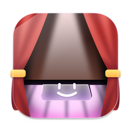
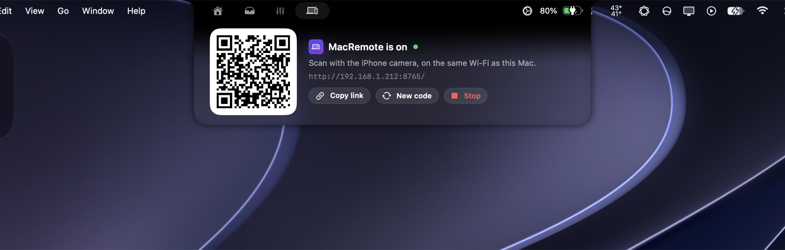
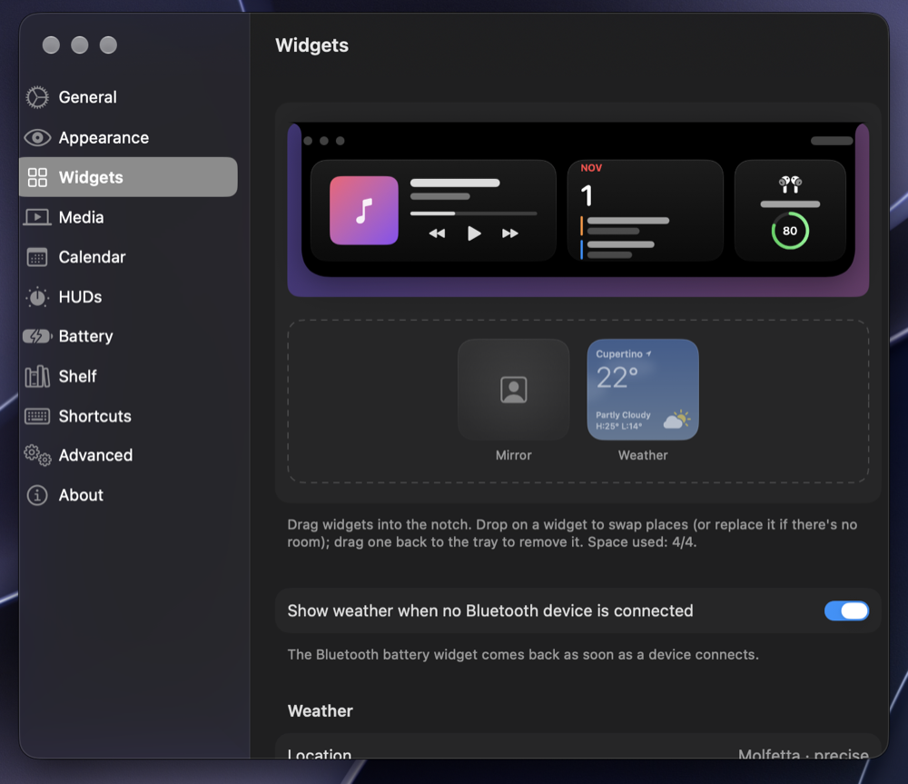
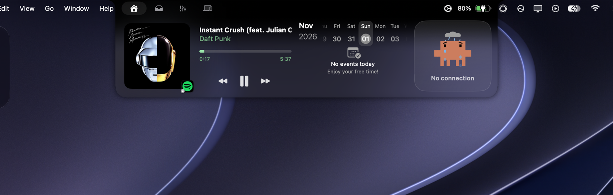
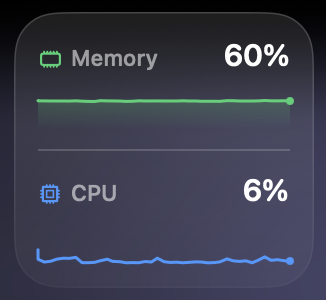
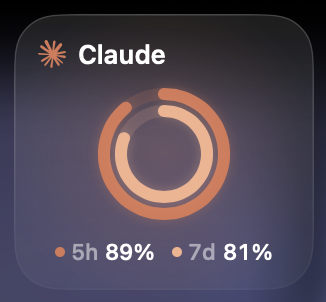
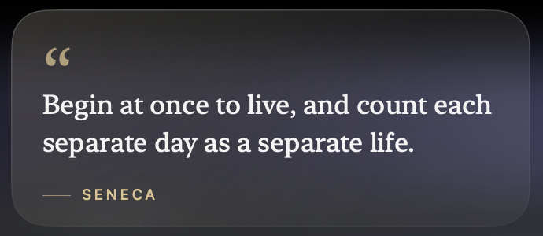
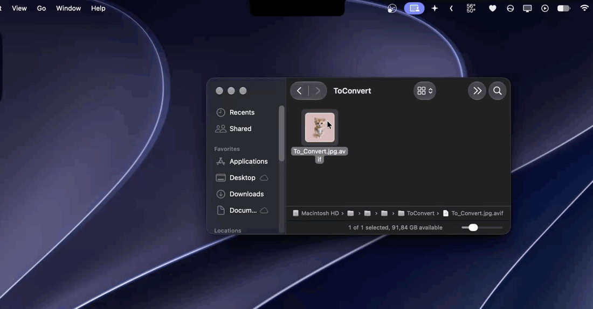
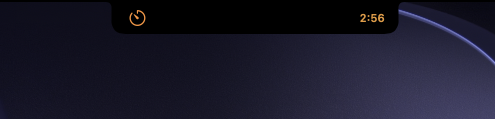
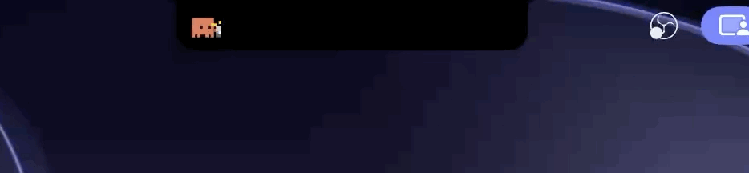

<div align="center">



# DullNotch-Notch Enhanced

**A Liquid Glass remake of [Boring Notch](https://github.com/TheBoredTeam/boring.notch) for macOS 26 and later.**<br>


[](LICENSE)
[](#requirements)
[](https://developer.apple.com/swift/)

[English](#english) · [Italiano](#italiano)

<br>


<br><br>

<table>
  <tr>
    <td align="center" width="60%">
      <br>
      <sub><b>Mixer</b>: per-app volume, powered by OpenSoundSource</sub>
    </td>
    <td align="center" width="40%">
      <br>
      <sub><b>HUD</b>: color presets, custom color, live preview</sub>
    </td>
  </tr>
  <tr>
    <td align="center" width="60%">
      <br>
      <sub><b>MacRemote</b>: control the Mac from your iPhone, paired from the notch</sub>
    </td>
    <td align="center" width="40%">
      <br>
      <sub><b>Widgets</b>: drag and drop to build your home</sub>
    </td>
  </tr>
</table>

</div>

---

## English

DullNotch-Notch Enhanced is a personal remake of **[Boring Notch](https://github.com/TheBoredTeam/boring.notch)** by TheBoredTeam. It keeps everything that makes the original great (music, calendar, shelf, HUDs, smooth Apple-style animations) and redesigns the look for the Liquid Glass era, plus a few new features.

> This is not a fork and is not affiliated with TheBoredTeam. All credit for the original app goes to them. The project stays under the same **GPL-3.0** license.

### Quick install

Download the latest release, no Xcode needed:

1. Open the **[latest release](https://github.com/jimmyxan/DullNotch-Notch-Enhanced/releases/latest)** and download `DullNotch-x.y.z.zip` under *Assets*.
2. Unzip it and drag **DullNotch.app** into your **Applications** folder.
3. If the original Boring Notch is installed, quit it and move it to the Trash: both apps share the same bundle identifier.
4. Open the app. It is not notarized by Apple, so the first launch is blocked: go to **System Settings › Privacy & Security**, scroll down and click **Open Anyway** next to DullNotch, then confirm.
   Prefer the Terminal? Run `xattr -dr com.apple.quarantine /Applications/DullNotch.app` and open the app normally.
5. The app lives in the notch and in the **menu bar** (no Dock icon). Use the menu bar item to open **Settings** or **Quit**.
6. Grant permissions when you need them:
   - **Accessibility**, to replace the system volume and brightness HUD (Settings › HUDs).
   - **Audio capture**, asked the first time you move a fader in the Mixer.
   - **Calendar**, to show your events.
   - **Bluetooth**, for the battery widget (AirPods, headphones, speakers).
   - **Location**, for the weather widget. Without it the weather uses an approximate position from your IP address.
   - **Accessibility for MacRemote**, the first time you start it from the notch (it is a separate helper app).

When a new version is published on GitHub, DullNotch tells you: **Update Now** opens the release page, **Remind Me Tomorrow** asks again the next day (Settings › About can turn this off, and *Check for Updates…* checks right away). To update, download the newest release and replace the app in Applications. Afterwards, remove and re-add the app under *Accessibility*: macOS ties the permission to the exact build.

### What's new

| | |
|---|---|
| **Liquid Glass** | The open notch becomes real system glass (`glassEffect`), adapting live to the wallpaper and the apps underneath. The closed notch stays pure black so it blends with the hardware notch. |
| **Glass intensity** | A 0–100% slider. 0% is the classic black look; 100% uses the clearer glass variant. |
| **Seamless top edge** | The black band under the physical notch melts into the glass with an eased gradient: no visible seam. |
| **Readable by design** | A dimming floor keeps text legible on any background. *Reduce Transparency* switches back to solid black; *Increase Contrast* raises the floor. |
| **HUD colors** | Volume, brightness and keyboard HUDs: white, system accent, 11 macOS system colors or any custom color, with gradient, glow and a live preview. |
| **Mixer** | A new notch tab with one vertical fader per app playing sound (0–150%), native and driver-free. See below. |
| **Spotify everywhere** | Shows what you are playing on your phone, speakers or TV, even with the Spotify app closed on the Mac. Works with **Spotify Free**, through Last.fm. |
| **Quiet idle state** | When nothing plays on any device, a calm Spotify card replaces the placeholder track. |
| **Home widgets** | Build the home like an iPhone widget stack: Music, Calendar, Bluetooth battery, Weather, Mirror, System monitor, AI usage and Quote. Up to 1 large + 2 small; the notch resizes to fit. |
| **Bluetooth battery** | AirPods and Beats show left, right and case; other headphones and speakers show one percentage. |
| **Weather** | Apple-style card with the sky and motion of the current condition. Can stand in for the battery widget while nothing is connected. |
| **MacRemote** | A new notch tab that starts **[MacRemote](https://github.com/jimmyxan/MacRemote)** and shows the QR code to pair your iPhone. Bundled with the app. |
| **Convert** | A new notch tab that converts images and text documents, PDF included, without uploading anything. Drag a file over the notch and pick the format. See below. |
| **Notch tabs** | Choose which tabs appear in the notch, each with a short description on hover. |
| **Progress on the closed notch** | The closed notch shows what is in progress: a Clock timer, a download, charging, or what is left of your AI plan. One at a time, by priority, in three styles. See below. |
| **Claude Code on the closed notch** | Claude's mascot hammers or types while Claude Code works, then celebrates or takes a coffee break for 20 seconds when it finishes. One click to connect. See below. |
| **System monitor** | CPU, memory, GPU, CPU and GPU temperature: pick one or two, each with a live graph of the last 2 minutes. |
| **AI usage** | Your Claude or Codex plan limits at a glance: 5-hour and weekly windows as concentric rings. |
| **Update notice** | A new GitHub release is announced in the app: update now or get a reminder tomorrow. |
| **Quote** | A quiet, editorial quote in a small or large widget, changing every 6 hours. |

### Home widgets



The home of the open notch is a set of widgets you choose and arrange in **Settings › Widgets**:

- **Drag and drop on a live preview**: drag a widget from the tray into the notch, drop it on another widget to swap them (or to replace it when there is no room), drag it back to the tray to remove it. A list below does the same for keyboard users.
- **Size budget**: Music is large, the others are small, and the home holds up to **1 large + 2 small**. The notch grows and shrinks with what you put in it.
- **Bluetooth battery**: an animated ring with the level of the connected device. Click it with AirPods or Beats connected to open a detail view with **Left**, **Right** and **Case** (the case only appears while it is nearby and reporting).
- **Weather**: data from [Open-Meteo](https://open-meteo.com) (free, no API key). Rain, snow, thunderstorms, clouds and fog are animated, gently. Location comes from Location Services, or from your IP address if you don't allow it; you can grant it again or refresh from Settings. With no internet connection the widget shows the Claude Code mascot crying under a rain cloud (above).
- **Weather when nothing is connected** (on by default): while no Bluetooth device is connected, the battery widget is replaced by the weather, and it comes back as soon as a device connects.

<p align="center">
  
  &nbsp;&nbsp;
  
</p>

- **System monitor**: choose up to two of CPU, Memory, GPU, CPU temp and GPU temp (Settings › Widgets). Each shows its current value and a graph of the last 2 minutes, so spikes stand out; hover to see the 2-minute peak. It samples every 3 seconds only while the widget is in the notch, costing microseconds for CPU and memory. Temperatures are the average of the CPU and GPU die sensors (Apple silicon).
- **AI usage**: what's left of your **Claude** (Pro / Max) or **Codex** (ChatGPT, free plan included) limits. The outer ring is the 5-hour window, the inner one the week; hover to see when each resets. No API key: it reuses the sign-in of Claude Code (`claude`) or Codex (`codex login`), and Settings › Widgets walks you through it step by step. The sign-in never leaves your Mac except to read your limits from Anthropic or OpenAI.

<p align="center">
  
</p>

- **Quote**: a hand-picked line in a serif face, with the author in small caps (hover to see the book, letter or poem it comes from). Two sizes: **Quote** (small) uses short lines, **Quote (large)** takes the place of a large widget and uses longer ones. 86 quotes from Seneca, Marcus Aurelius, Rilke, Mary Oliver, Annie Dillard, Baldwin, Camus, Kafka, Le Guin, Musashi and others, each traced to a written source: no unsourced internet quotes. A new one every 6 hours, each shown once before the cycle starts over; it is worked out from the time, so it costs nothing in the background.

### MacRemote

The **MacRemote** tab, next to the Mixer, integrates **[MacRemote](https://github.com/jimmyxan/MacRemote)** ([macremote.it](https://www.macremote.it)), my app to control the Mac from an iPhone over the local network: volume, media, brightness, keyboard, touchpad and more, from a web page in Safari. Nothing to install on the phone.

- **Included in every install**: MacRemote is built from its own repository (a git submodule) and shipped inside `DullNotch.app`. There is nothing else to download.
- **Start → scan → done**: press **Start MacRemote**, scan the QR code with the iPhone camera (same Wi-Fi), and the remote opens.
- **Copy link**, **New code** (phones paired with the old link stop working) and **Stop** (MacRemote quits completely).
- If you already run a standalone MacRemote, the tab uses that one instead of starting a second copy.
- MacRemote runs as its own app, because it needs permissions the sandboxed notch cannot have (simulating keys and pointer, screen preview). macOS asks for **Accessibility** for MacRemote the first time.

If you find MacRemote useful, a ⭐ on [its repository](https://github.com/jimmyxan/MacRemote) helps.

### Mixer: native OpenSoundSource engine

The Mixer tab is built on the audio engine of **[OpenSoundSource](https://github.com/jimmyxan/OpenSoundSource)**, my per-app volume app for the menu bar. It is integrated natively, not as a plugin or a separate process:

- **CoreAudio process taps** (macOS 14.2+), no virtual audio driver to install.
- **Helper processes are grouped under their app**: Safari (WebKit GPU process), Chrome, Teams and Electron apps show up as one fader, a problem already solved in OpenSoundSource.
- **0–150%** with a magnetic snap at 100% and a soft-knee limiter, so boosted audio does not clip.
- **Zero cost at 100%**: the tap is removed when an app is back at unity gain.
- **Follows your devices**: volumes carry over when the default output changes, for example when you put on AirPods.
- **Fine control in a small space**: relative dragging (the knob never jumps), hold **⌥ Option** for 4× finer steps, click the percentage to reset, click the icon to mute.

The first time you move a fader, macOS asks for permission to capture app audio.

### Convert

<p align="center">
  
</p>

The **Convert** tab changes a file's format right on your Mac, with the frameworks macOS already has (ImageIO, PDFKit, AppKit). Nothing is uploaded and nothing leaves the computer.

- **Drag and drop**: drag a file over the notch and Convert opens by itself. The format is detected and shown as a badge (AVIF, PNG, DOCX…).
- **Only formats that make sense**: you see only targets that fit the source, never the format you already have.
- **Images**: reads PNG, JPEG, HEIC, AVIF, WebP, TIFF, GIF, BMP and camera RAW; saves as PNG, JPEG, HEIC, TIFF, GIF, BMP or PDF. GIF and TIFF keep every frame.
- **Text**: reads TXT, Markdown, RTF, HTML, DOCX, DOC and ODT; saves as TXT, RTF, HTML, DOCX, ODT, DOC or PDF.
- **PDF**: extract the text (TXT, RTF, DOCX…) or turn the pages into images. A scanned PDF has no text to extract, and Convert tells you so.
- **You choose where it goes**: the standard Save dialog opens on the original's folder, with the new name ready. Then **Show in Finder** or **Convert another**.

In **Settings → General → Notch tabs** you choose which tabs to show and whether a dragged file opens Convert or the Shelf. Home, Mixer, MacRemote and Convert are on by default; the Shelf is off.

### Progress on the closed notch

<table>
  <tr>
    <td align="center" width="33%"><br><sub><b>Wings</b>: icon on the left, time or ring on the right</sub></td>
    <td align="center" width="33%"><br><sub><b>Wire</b>: a line that runs around the notch</sub></td>
    <td align="center" width="33%"><br><sub><b>Hybrid</b>: the line, plus one icon on the left</sub></td>
  </tr>
</table>

The closed notch shows the progress of what is going on, without opening it. Only one thing is shown at a time; the first one in progress wins, in this order:

1. **Clock timers**: a timer running in the macOS Clock app. The line starts full and drains, and turns red near the end.
2. **Downloads**: a file being downloaded into your Downloads folder, with its percentage when the browser publishes it.
3. **Charging**: only while the battery level is actually going up. A charge held at 80% is not shown.
4. **AI quota**: what is left of your Claude or Codex 5-hour limit, shown when nothing else is in progress and the service is connected.

In **Settings → Progress** you pick the style, turn each source on or off, and decide whether progress takes the place of music on the closed notch. The AI quota never replaces music.

Timers are read from the Clock app's own data, with no extra permission. This relies on a format Apple does not document, so a macOS update may break it. A new timer or download can take up to 5 seconds to appear.

### Claude Code on the closed notch

<p align="center"></p>

While Claude Code works, Claude's pixel mascot sits on the closed notch and hammers on a block or types on a keyboard, picked at random each turn. When Claude finishes it hops with its arms up or sips a coffee for 20 seconds, then disappears. While Claude waits for you (a question, a permission) nothing is shown, and pressing Esc hides the mascot within a few seconds.

To connect it, open **Settings → Progress → Claude Code** and click **Connect Claude Code**. DullNotch adds a few hooks to `~/.claude/settings.json`, keeps your other hooks, and saves a backup next to the file; **Disconnect** removes them. Nothing else to install.

The mascot follows the other closed-notch views: with **Wings** it takes the icon's place on the left, with **Hybrid** it takes the right wing, with **Wire** or with nothing else going on it gets a wing on the left, and with music it takes the album art's place.

### Performance

- The glass is composited by WindowServer: no screen capture and no per-frame CPU work. It exists only while the notch is open and the slider is above 0%.
- The Mixer polls once per second only while its tab is visible, every 3 s while a custom volume is active, and not at all otherwise.
- Progress on the closed notch checks the Clock timers and the Downloads folder every 5 s, and once per second only while a timer runs. With a timer running it used well under 1% of one CPU core in our measurements.
- Claude's mascot draws 6 frames a second only while it is on screen: about 2% of one CPU core. While Claude works, the session status is read every 2 s; when the mascot is hidden nothing runs.
- With Spotify closed, Last.fm is checked every 15 s while music plays and every 60 s when idle. Spotify is never launched in the background.

### Spotify on other devices with Last.fm (tutorial)

Spotify's own Web API now requires Premium. Last.fm does not: Spotify sends your plays to Last.fm from every device, Free accounts included.

1. **Create a Last.fm account** at [last.fm/join](https://www.last.fm/join) (skip if you have one).
2. **Connect Spotify**: open [last.fm/settings/applications](https://www.last.fm/settings/applications) and click **Connect** next to *Spotify Scrobbling*.
3. **Get a free API key**: go to [last.fm/api/account/create](https://www.last.fm/api/account/create). Enter any application name (for example *DullNotch*) and a short description. Leave *Callback URL* empty. Submit and copy the **API key**. You do not need the *Shared secret*: do not paste it anywhere.
4. **Set up the notch**: open the notch settings › **Media**, set **Music Source** to **Spotify**, then fill **Last.fm username** and **Last.fm API key** in *Spotify on other devices*.
5. **Try it**: close Spotify on the Mac and play something on your phone. Within about 15 seconds the notch shows the track. Your Last.fm profile should say *Scrobbling now*.

Good to know:
- Read-only: track, artist, album and artwork. Progress is estimated. Playback controls work only when the Spotify app is open on the Mac (no Premium needed).
- When you pause, Last.fm keeps the track as *now playing* for a few minutes.
- Your API key is stored only in the app's local preferences, never in this repository.

### Requirements

- macOS 14 or later. Liquid Glass needs macOS 26; on older systems the notch uses the classic blur.
- Mixer: macOS 14.2 or later.
- Xcode 26 to build.

### Build from source

```bash
git clone --recursive https://github.com/jimmyxan/DullNotch-Notch-Enhanced.git
cd DullNotch-Notch-Enhanced
open boringNotch.xcodeproj
```

Already cloned without `--recursive`? Run `git submodule update --init`. The build compiles the MacRemote submodule with Swift Package Manager and embeds it.

Select the `boringNotch` scheme and press **Run**. Accessibility permission is required to replace the system HUD.

> Automatic update checks are disabled: the bundled Sparkle feed belongs to the original Boring Notch and would replace this build.

### Credits

- **[Boring Notch](https://github.com/TheBoredTeam/boring.notch)** by TheBoredTeam and contributors: the original app this remake is built on.
- **[OpenSoundSource](https://github.com/jimmyxan/OpenSoundSource)**: the per-app volume engine behind the Mixer.
- **[MacRemote](https://github.com/jimmyxan/MacRemote)** ([macremote.it](https://www.macremote.it)): the iPhone remote behind the MacRemote tab, included as a submodule.
- Weather data by **[Open-Meteo](https://open-meteo.com)** (CC BY 4.0); IP location fallback by [ipwho.is](https://ipwho.is).
- Licensed under **GPL-3.0**, like the original. See [LICENSE](LICENSE) and [THIRD_PARTY_LICENSES](THIRD_PARTY_LICENSES).

---

## Italiano

DullNotch-Notch Enhanced è un remake personale di **[Boring Notch](https://github.com/TheBoredTeam/boring.notch)** di TheBoredTeam. Mantiene tutto ciò che rende ottimo l'originale (musica, calendario, shelf, HUD, animazioni fluide in stile Apple) e ridisegna l'aspetto per l'era Liquid Glass, con qualche funzione nuova.

> Non è un fork e non è affiliato a TheBoredTeam. Tutto il merito dell'app originale va a loro. Il progetto resta sotto la stessa licenza **GPL-3.0**.

### Installazione rapida

Scarica l'ultima release, senza bisogno di Xcode:

1. Apri l'**[ultima release](https://github.com/jimmyxan/DullNotch-Notch-Enhanced/releases/latest)** e scarica `DullNotch-x.y.z.zip` sotto *Assets*.
2. Estrai lo zip e trascina **DullNotch.app** nella cartella **Applicazioni**.
3. Se hai installato il Boring Notch originale, chiudilo e spostalo nel Cestino: le due app usano lo stesso identificativo.
4. Apri l'app. Non è notarizzata da Apple, quindi il primo avvio viene bloccato: vai in **Impostazioni di Sistema › Privacy e sicurezza**, scorri in basso e premi **Apri comunque** accanto a DullNotch, poi conferma.
   Preferisci il Terminale? Esegui `xattr -dr com.apple.quarantine /Applications/DullNotch.app` e apri l'app normalmente.
5. L'app vive nel notch e nella **barra dei menu** (nessuna icona nel Dock). Dall'icona nella barra dei menu apri le **Impostazioni** o **esci**.
6. Concedi i permessi quando servono:
   - **Accessibilità**, per sostituire le HUD di volume e luminosità di sistema (Impostazioni › HUDs).
   - **Cattura audio**, richiesta la prima volta che muovi uno slider nel Mixer.
   - **Calendario**, per mostrare i tuoi eventi.
   - **Bluetooth**, per il widget batteria (AirPods, cuffie, casse).
   - **Posizione**, per il widget meteo. Senza permesso il meteo usa una posizione approssimata dall'indirizzo IP.
   - **Accessibilità per MacRemote**, la prima volta che lo avvii dal notch (è un'app di supporto separata).

Quando su GitHub esce una nuova versione, DullNotch te lo dice: **Update Now** apre la pagina della release, **Remind Me Tomorrow** te lo ricorda il giorno dopo (puoi disattivarlo in Impostazioni › About, e *Check for Updates…* controlla subito). Per aggiornare, scarica la release più recente e sostituisci l'app in Applicazioni. Poi rimuovi e riaggiungi l'app in *Accessibilità*: macOS lega il permesso alla build esatta.

### Novità

| | |
|---|---|
| **Liquid Glass** | Il notch aperto diventa vero vetro di sistema (`glassEffect`), che si adatta in tempo reale allo sfondo e alle app sottostanti. Il notch chiuso resta nero pieno, così si fonde con il notch fisico. |
| **Intensità del vetro** | Uno slider da 0 a 100%. Lo 0% è il classico nero; il 100% usa la variante di vetro più trasparente. |
| **Bordo superiore senza stacchi** | La fascia nera sotto il notch fisico sfuma nel vetro con un gradiente morbido: nessuna linea visibile. |
| **Leggibile per design** | Uno strato scuro minimo mantiene i testi leggibili su qualsiasi sfondo. *Riduci trasparenza* torna al nero pieno; *Aumenta contrasto* scurisce di più. |
| **Colori HUD** | HUD di volume, luminosità e tastiera: bianco, accento di sistema, 11 colori di sistema macOS o qualsiasi colore personalizzato, con gradiente, glow e anteprima dal vivo. |
| **Mixer** | Una nuova tab del notch con uno slider verticale per ogni app che emette suono (0–150%), nativo e senza driver. Vedi sotto. |
| **Spotify ovunque** | Mostra cosa ascolti su telefono, casse o TV, anche con l'app Spotify chiusa sul Mac. Funziona con **Spotify Free**, tramite Last.fm. |
| **Stato di attesa discreto** | Quando non suona nulla su nessun dispositivo, una scheda Spotify sobria sostituisce il brano segnaposto. |
| **Widget nella home** | Componi la home come i widget di iPhone: Musica, Calendario, Batteria Bluetooth, Meteo, Specchio, Monitor di sistema, Utilizzo AI e Citazione. Fino a 1 grande + 2 piccoli; il notch si adatta. |
| **Batteria Bluetooth** | AirPods e Beats mostrano sinistra, destra e custodia; altre cuffie e casse una sola percentuale. |
| **Meteo** | Scheda in stile Apple con il cielo e il movimento della condizione attuale. Può prendere il posto della batteria quando non c'è nulla collegato. |
| **MacRemote** | Una nuova tab del notch che avvia **[MacRemote](https://github.com/jimmyxan/MacRemote)** e mostra il QR per associare l'iPhone. Inclusa nell'app. |
| **Converti** | Una nuova tab del notch che converte immagini e documenti di testo, PDF compresi, senza caricare nulla online. Trascina un file sul notch e scegli il formato. Vedi sotto. |
| **Tab del notch** | Scegli quali tab mostrare nel notch; ognuna ha una breve descrizione al passaggio del mouse. |
| **Avanzamento nel notch chiuso** | Il notch chiuso mostra ciò che è in corso: un timer di Orologio, un download, la ricarica o quanto resta del piano AI. Uno alla volta, per priorità, in tre stili. Vedi sotto. |
| **Claude Code nel notch chiuso** | La mascotte di Claude martella o batte sulla tastiera mentre Claude Code lavora, poi festeggia o si prende un caffè per 20 secondi quando ha finito. Si collega con un clic. Vedi sotto. |
| **Monitor di sistema** | CPU, memoria, GPU, temperatura di CPU e GPU: scegline uno o due, ciascuno con un grafico dal vivo degli ultimi 2 minuti. |
| **Utilizzo AI** | I limiti del tuo piano Claude o Codex a colpo d'occhio: finestra di 5 ore e settimanale come anelli concentrici. |
| **Avviso aggiornamenti** | Una nuova release su GitHub viene segnalata nell'app: aggiorna subito o ricevi un promemoria il giorno dopo. |
| **Citazione** | Una citazione sobria ed elegante in un widget piccolo o grande, che cambia ogni 6 ore. |

### Widget nella home

La home del notch aperto è un insieme di widget che scegli e disponi in **Impostazioni › Widgets**:

- **Trascina e rilascia su un'anteprima dal vivo**: trascina un widget dal vassoio nel notch, rilascialo su un altro per scambiarli (o per sostituirlo se manca spazio), riportalo nel vassoio per toglierlo. Una lista sotto fa lo stesso da tastiera.
- **Spazio a disposizione**: Musica è grande, gli altri sono piccoli, e la home contiene fino a **1 grande + 2 piccoli**. Il notch si allarga e si restringe in base a cosa contiene.
- **Batteria Bluetooth**: un anello animato con la carica del dispositivo collegato. Con AirPods o Beats un clic apre il dettaglio con **Sinistra**, **Destra** e **Custodia** (la custodia compare solo se è vicina e comunica la carica).
- **Meteo**: dati da [Open-Meteo](https://open-meteo.com) (gratuito, senza chiave). Pioggia, neve, temporali, nuvole e nebbia sono animati, con discrezione. La posizione arriva da Localizzazione o, se non la concedi, dall'indirizzo IP; dalle Impostazioni puoi concederla di nuovo o aggiornare. Senza connessione internet il widget mostra la mascotte di Claude Code che piange sotto una nuvola di pioggia (immagine sopra).
- **Meteo quando non c'è nulla collegato** (attivo di default): finché nessun dispositivo Bluetooth è collegato, al posto della batteria compare il meteo, che torna batteria appena un dispositivo si collega.

<p align="center">
  
  &nbsp;&nbsp;
  
</p>

- **Monitor di sistema**: scegli fino a due parametri tra CPU, Memoria, GPU, temperatura CPU e temperatura GPU (Impostazioni › Widgets). Ognuno mostra il valore attuale e un grafico degli ultimi 2 minuti, così i picchi si vedono subito; passa il mouse per vedere il picco dei 2 minuti. Campiona ogni 3 secondi solo finché il widget è nel notch, con un costo di microsecondi per CPU e memoria. Le temperature sono la media dei sensori del die di CPU e GPU (Apple silicon).
- **Utilizzo AI**: quanto ti resta dei limiti di **Claude** (Pro / Max) o **Codex** (ChatGPT, anche piano gratuito). L'anello esterno è la finestra di 5 ore, quello interno la settimana; passa il mouse per vedere quando si azzerano. Nessuna chiave API: usa l'accesso di Claude Code (`claude`) o di Codex (`codex login`), e Impostazioni › Widgets ti guida passo per passo. L'accesso non lascia mai il Mac, se non per leggere i limiti da Anthropic o OpenAI.

<p align="center">
  
</p>

- **Citazione** (in inglese): una frase scelta a mano in carattere serif, con l'autore in maiuscoletto (passa il mouse per vedere il libro, la lettera o la poesia da cui viene). Due misure: **Quote** (piccolo) usa frasi brevi, **Quote (large)** prende il posto di un widget grande e usa quelle più lunghe. 86 citazioni da Seneca, Marco Aurelio, Rilke, Mary Oliver, Annie Dillard, Baldwin, Camus, Kafka, Le Guin, Musashi e altri, ognuna con una fonte scritta: niente frasi da internet senza origine. Ne arriva una nuova ogni 6 ore, ciascuna una sola volta prima che il giro ricominci; viene calcolata dall'ora, quindi non consuma nulla in background.

### MacRemote

La tab **MacRemote**, accanto al Mixer, integra **[MacRemote](https://github.com/jimmyxan/MacRemote)** ([macremote.it](https://www.macremote.it)), la mia app per comandare il Mac dall'iPhone sulla rete locale: volume, media, luminosità, tastiera, touchpad e altro, da una pagina web in Safari. Niente da installare sul telefono.

- **Inclusa in ogni installazione**: MacRemote viene compilata dal suo repository (un submodule git) e inserita dentro `DullNotch.app`. Non c'è altro da scaricare.
- **Avvia → inquadra → fatto**: premi **Start MacRemote**, inquadra il QR con la fotocamera dell'iPhone (stessa Wi-Fi) e si apre il telecomando.
- **Copy link**, **New code** (i telefoni associati con il vecchio link smettono di funzionare) e **Stop** (MacRemote si chiude del tutto).
- Se usi già MacRemote installata a parte, la tab usa quella invece di avviarne una seconda copia.
- MacRemote gira come app a sé perché le servono permessi che il notch in sandbox non può avere (simulare tasti e puntatore, anteprima dello schermo). La prima volta macOS chiede il permesso **Accessibilità** per MacRemote.

Se MacRemote ti è utile, una ⭐ sul [suo repository](https://github.com/jimmyxan/MacRemote) aiuta.

### Mixer: motore nativo di OpenSoundSource

La tab Mixer usa il motore audio di **[OpenSoundSource](https://github.com/jimmyxan/OpenSoundSource)**, la mia app per il volume per singola app dalla barra dei menu. È integrato in modo nativo, non come plugin o processo separato:

- **Process tap di CoreAudio** (macOS 14.2+), nessun driver audio virtuale da installare.
- **I processi helper sono raggruppati sotto la loro app**: Safari (processo GPU di WebKit), Chrome, Teams e le app Electron compaiono come un solo slider, problema già risolto in OpenSoundSource.
- **0–150%** con aggancio magnetico al 100% e limitatore morbido, così l'audio amplificato non distorce.
- **Costo zero al 100%**: il tap viene rimosso quando un'app torna al volume pieno.
- **Segue i tuoi dispositivi**: i volumi restano quando cambia l'uscita predefinita, per esempio quando indossi le AirPods.
- **Controllo fine in poco spazio**: trascinamento relativo (il pallino non salta), tieni premuto **⌥ Option** per passi 4 volte più fini, clic sulla percentuale per tornare al 100%, clic sull'icona per silenziare.

La prima volta che muovi uno slider, macOS chiede il permesso di catturare l'audio delle app.

### Converti

<p align="center">
  
</p>

La tab **Converti** (*Convert* nell'app) cambia il formato di un file direttamente sul Mac, con gli strumenti che macOS ha già (ImageIO, PDFKit, AppKit). Non carica nulla online e nulla esce dal computer.

- **Trascina e rilascia**: trascina un file sul notch e Converti si apre da sola. Il formato viene riconosciuto e mostrato in un'etichetta (AVIF, PNG, DOCX…).
- **Solo formati sensati**: vedi solo destinazioni coerenti con il file di partenza, mai il formato che hai già.
- **Immagini**: legge PNG, JPEG, HEIC, AVIF, WebP, TIFF, GIF, BMP e RAW delle fotocamere; salva in PNG, JPEG, HEIC, TIFF, GIF, BMP o PDF. GIF e TIFF tengono tutti i fotogrammi.
- **Testo**: legge TXT, Markdown, RTF, HTML, DOCX, DOC e ODT; salva in TXT, RTF, HTML, DOCX, ODT, DOC o PDF.
- **PDF**: estrai il testo (TXT, RTF, DOCX…) o trasforma le pagine in immagini. Un PDF scansionato non ha testo da estrarre, e Converti te lo dice.
- **Scegli tu dove salvarlo**: si apre la finestra Salva di macOS nella cartella dell'originale, con il nuovo nome già pronto. Poi **Show in Finder** o **Convert another**.

In **Impostazioni → General → Notch tabs** scegli quali tab mostrare e se un file trascinato apre Converti o lo Shelf. Di default sono attive Home, Mixer, MacRemote e Converti; lo Shelf è spento.

### Avanzamento nel notch chiuso

<table>
  <tr>
    <td align="center" width="33%"><br><sub><b>Wings</b>: icona a sinistra, tempo o anello a destra</sub></td>
    <td align="center" width="33%"><br><sub><b>Wire</b>: una linea che corre attorno al notch</sub></td>
    <td align="center" width="33%"><br><sub><b>Hybrid</b>: la linea, più un'icona a sinistra</sub></td>
  </tr>
</table>

Il notch chiuso mostra l'avanzamento di ciò che è in corso, senza aprirlo. Si vede una cosa sola alla volta; vince la prima in corso, in quest'ordine:

1. **Timer di Orologio** (*Clock timers*): un timer avviato nell'app Orologio di macOS. La linea parte piena e si svuota, e diventa rossa verso la fine.
2. **Download** (*Downloads*): un file in scaricamento nella cartella Download, con la percentuale quando il browser la pubblica.
3. **Ricarica** (*Charging*): solo mentre il livello della batteria sale davvero. Una carica ferma all'80% non viene mostrata.
4. **Quota AI** (*AI quota*): quanto resta del limite di 5 ore di Claude o Codex, mostrato quando non c'è altro in corso e il servizio è collegato.

In **Impostazioni → Progress** scegli lo stile, accendi o spegni ogni fonte e decidi se l'avanzamento prende il posto della musica nel notch chiuso. La quota AI non sostituisce mai la musica.

I timer sono letti dai dati dell'app Orologio, senza permessi aggiuntivi. Il formato non è documentato da Apple, quindi un aggiornamento di macOS può interromperne il funzionamento. Un timer o un download nuovo può comparire con fino a 5 secondi di ritardo.

### Claude Code nel notch chiuso

<p align="center"></p>

Mentre Claude Code lavora, la mascotte pixel di Claude compare nel notch chiuso e martella un blocco o batte sulla tastiera, scelti a caso a ogni turno. Quando Claude finisce saltella con le braccia in alto o beve un caffè per 20 secondi, poi sparisce. Mentre Claude aspetta te (una domanda, un permesso) non si vede nulla, e premendo Esc la mascotte sparisce in pochi secondi.

Per collegarla apri **Impostazioni → Progress → Claude Code** e premi **Connect Claude Code**. DullNotch aggiunge alcuni hook a `~/.claude/settings.json`, lascia gli altri e salva una copia accanto al file; **Disconnect** li toglie. Non c'è altro da installare.

La mascotte segue le altre viste del notch chiuso: con **Wings** prende il posto dell'icona a sinistra, con **Hybrid** l'ala destra, con **Wire** o quando non c'è altro un'ala a sinistra, con la musica il posto della copertina.

### Prestazioni

- Il vetro è composto da WindowServer: nessuna cattura dello schermo e nessun lavoro della CPU a ogni frame. Esiste solo a notch aperto e con lo slider sopra lo 0%.
- Il Mixer si aggiorna una volta al secondo solo con la sua tab visibile, ogni 3 s se c'è un volume personalizzato attivo, altrimenti mai.
- L'avanzamento nel notch chiuso controlla i timer di Orologio e la cartella Download ogni 5 s, e una volta al secondo solo mentre un timer è in corso. Con un timer in corso ha usato ben meno dell'1% di un core nelle nostre misure.
- La mascotte di Claude disegna 6 fotogrammi al secondo solo mentre è visibile: circa il 2% di un core. Mentre Claude lavora, lo stato della sessione viene letto ogni 2 s; a mascotte nascosta non gira nulla.
- Con Spotify chiuso, Last.fm viene controllato ogni 15 s durante l'ascolto e ogni 60 s quando non suona nulla. Spotify non viene mai avviato in background.

### Spotify su altri dispositivi con Last.fm (tutorial)

La Web API di Spotify ora richiede Premium. Last.fm no: Spotify invia a Last.fm i tuoi ascolti da ogni dispositivo, anche con account Free.

1. **Crea un account Last.fm** su [last.fm/join](https://www.last.fm/join) (salta se ne hai già uno).
2. **Collega Spotify**: apri [last.fm/settings/applications](https://www.last.fm/settings/applications) e premi **Connect** accanto a *Spotify Scrobbling*.
3. **Ottieni una chiave API gratuita**: vai su [last.fm/api/account/create](https://www.last.fm/api/account/create). Inserisci un nome qualsiasi (per esempio *DullNotch*) e una breve descrizione. Lascia vuoto *Callback URL*. Invia e copia la **API key**. Lo *Shared secret* non serve: non incollarlo da nessuna parte.
4. **Configura il notch**: apri le impostazioni del notch › **Media**, imposta **Music Source** su **Spotify**, poi compila **Last.fm username** e **Last.fm API key** in *Spotify on other devices*.
5. **Prova**: chiudi Spotify sul Mac e fai partire un brano dal telefono. Entro circa 15 secondi il notch mostra il brano. Il tuo profilo Last.fm dovrebbe indicare *Scrobbling now*.

Da sapere:
- Solo lettura: brano, artista, album e copertina. L'avanzamento è stimato. I controlli funzionano solo con l'app Spotify aperta sul Mac (senza bisogno di Premium).
- Quando metti in pausa, Last.fm mostra il brano come *now playing* ancora per qualche minuto.
- La chiave API resta solo nelle preferenze locali dell'app, mai in questo repository.

### Requisiti

- macOS 14 o successivo. Il Liquid Glass richiede macOS 26; sui sistemi precedenti il notch usa la sfocatura classica.
- Mixer: macOS 14.2 o successivo.
- Xcode 26 per compilare.

### Compilazione dal codice

```bash
git clone --recursive https://github.com/jimmyxan/DullNotch-Notch-Enhanced.git
cd DullNotch-Notch-Enhanced
open boringNotch.xcodeproj
```

Hai già clonato senza `--recursive`? Esegui `git submodule update --init`. La build compila il submodule MacRemote con Swift Package Manager e lo include nell'app.

Seleziona lo schema `boringNotch` e premi **Run**. Per sostituire le HUD di sistema serve il permesso Accessibilità.

> I controlli automatici degli aggiornamenti sono disattivati: il feed Sparkle incluso appartiene al Boring Notch originale e sostituirebbe questa build.

### Crediti

- **[Boring Notch](https://github.com/TheBoredTeam/boring.notch)** di TheBoredTeam e collaboratori: l'app originale su cui si basa questo remake.
- **[OpenSoundSource](https://github.com/jimmyxan/OpenSoundSource)**: il motore di volume per singola app dietro il Mixer.
- **[MacRemote](https://github.com/jimmyxan/MacRemote)** ([macremote.it](https://www.macremote.it)): il telecomando per iPhone dietro la tab MacRemote, incluso come submodule.
- Dati meteo di **[Open-Meteo](https://open-meteo.com)** (CC BY 4.0); posizione da IP di riserva tramite [ipwho.is](https://ipwho.is).
- Licenza **GPL-3.0**, come l'originale. Vedi [LICENSE](LICENSE) e [THIRD_PARTY_LICENSES](THIRD_PARTY_LICENSES).
